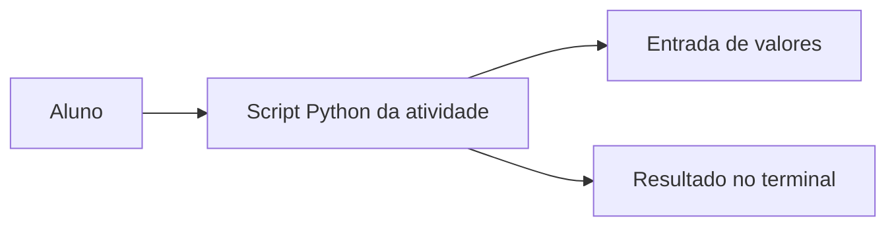

# Estrutura — Atividade1-EdN

Cada script é independente. Não existe uma arquitetura em camadas obrigatória neste laboratório.

Arquivos: saudacao.py, calculadoraSoma.py, calculadoraDeDimensao.py, calculadoraPrecoTotalCompra.py, calculadoraNumeroInteiro.py.
